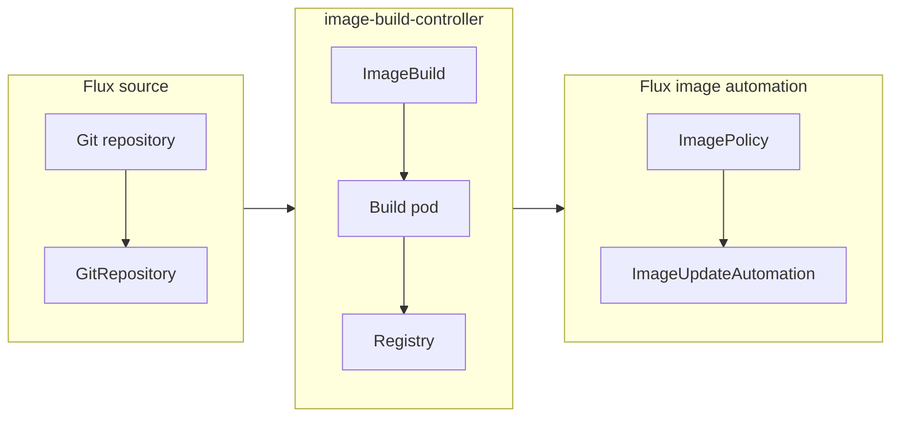

# image-build-controller

A Kubernetes controller that builds container images from [Flux](https://fluxcd.io) sources, so Flux image automation can deploy them.

Flux fetches Git repositories, updates image tags, and reconciles the cluster, but it doesn't build images.
For a project that doesn't publish an image, you would otherwise need a CI pipeline just to build one.
With image-build-controller, an `ImageBuild` resource builds the image inside the cluster whenever its `GitRepository` changes, and pushes it to a registry.
Flux image automation picks up the new tag from there.



Builds run as Kubernetes Jobs with rootless [BuildKit](https://github.com/moby/buildkit).

## Requirements

- Kubernetes.
  The project is tested on Kubernetes 1.36 and 1.37.
- Flux source-controller, for `GitRepository` sources.
- A registry that the build pods can push to.
- For user namespaces, which builds use by default: Kubernetes 1.33 or later, and nodes with Linux 6.3 or later and containerd 2.0 or later or CRI-O.
  See [User namespaces](#user-namespaces) to turn them off.

## Install

Install the Helm chart:

```sh
helm install image-build-controller oci://ghcr.io/leightweight/charts/image-build-controller \
  --namespace image-build-controller-system --create-namespace \
  --values values.yaml
```

Most clusters running Flux need this `values.yaml`:

```yaml
# Flux's default NetworkPolicies only allow traffic to source-controller from the flux-system namespace.
# flux bootstrap and flux install add them, and so do most other Flux installs.
# This policy lets build pods in any namespace download source artifacts.
# Without it, builds from a GitRepository time out in the fetch step on clusters whose CNI enforces NetworkPolicies.
sourceControllerNetworkPolicy:
  enabled: true
```

The policy is created in the `flux-system` namespace.
If source-controller runs elsewhere, set `sourceControllerNetworkPolicy.namespace`.
The chart's [`values.yaml`](charts/chart/values.yaml) lists the other settings.
Controller flags, such as `--default-user-namespaces=false`, go in `manager.args`.

Each release also has an `install.yaml` that installs the controller with default settings and without the NetworkPolicy:

```sh
kubectl apply -f https://github.com/leightweight/image-build-controller/releases/download/v0.1.0/install.yaml
```

### Verify the release

The release workflow signs the controller image and the chart with [cosign](https://github.com/sigstore/cosign), using its GitHub Actions identity instead of a key:

```sh
cosign verify ghcr.io/leightweight/image-build-controller:0.1.0 \
  --certificate-identity-regexp '^https://github.com/leightweight/image-build-controller/.github/workflows/release.yml@refs/tags/v' \
  --certificate-oidc-issuer https://token.actions.githubusercontent.com
```

The same command verifies the chart at `ghcr.io/leightweight/charts/image-build-controller:0.1.0`.

## Prepare a build namespace

Builds run in the namespace of their `ImageBuild`.

Rootless BuildKit needs the `Unconfined` seccomp profile, and the `Unconfined` AppArmor profile on nodes that run AppArmor.
The `baseline` Pod Security Standard rejects both, so the namespace must allow the `privileged` level:

```sh
kubectl label namespace apps pod-security.kubernetes.io/enforce=privileged
```

Build pods still run as a non-root user, without a service account token.

To push to a registry that needs credentials, create a `kubernetes.io/dockerconfigjson` Secret in the same namespace, the same format as `imagePullSecrets`:

```sh
kubectl create secret docker-registry regcreds --namespace apps \
  --docker-server=ghcr.io --docker-username=<user> --docker-password=<token>
```

Build pods mount the Secret directly.
The controller never reads Secrets, and its RBAC doesn't allow it to.

## Build an image

This `ImageBuild` builds the `Dockerfile` at the root of a `GitRepository` and pushes it to GHCR:

```yaml
apiVersion: build.fluxcd.leightweight.io/v1alpha1
kind: ImageBuild
metadata:
  name: app
  namespace: apps
spec:
  sourceRef:
    kind: GitRepository
    name: app
    namespace: flux-system
  dockerfile:
    path: Dockerfile
  push:
    image: ghcr.io/example/app
    secretRef:
      name: regcreds
```

The controller builds again when the `GitRepository` has a new artifact or a spec field that affects the image changes.
Each build pushes new tags.
Without `push.tags`, the tag depends on the source revision:

| Source revision | Default tag |
|---|---|
| A branch | `<branch>-<short SHA>-<Unix time>`, such as `main-1a2b3c4-1760000000` |
| A Git tag | `<tag>-<short SHA>-<Unix time>` |
| Only a commit | `<short SHA>-<Unix time>` |
| No source | `build-<Unix time>` |

`push.tags` takes Go templates with `.Branch`, `.Tag`, `.SHA`, `.ShortSHA`, `.Timestamp`, and `.Generation`.

An `ImageBuild` can also hold its Dockerfile inline.
Without a `sourceRef`, it builds from an empty context:

```yaml
apiVersion: build.fluxcd.leightweight.io/v1alpha1
kind: ImageBuild
metadata:
  name: tools
  namespace: apps
spec:
  dockerfile:
    inline: |
      FROM alpine:3.22
      RUN apk add --no-cache curl jq
  push:
    image: ghcr.io/example/tools
    secretRef:
      name: regcreds
  # Rebuild weekly to pick up base image security patches.
  rebuildInterval: 168h
```

`kubectl get imagebuilds` shows the result of each `ImageBuild`'s last build:

```console
$ kubectl get imagebuilds -n apps
NAME    READY   REVISION                                             LATEST IMAGE                                                                     AGE
app     True    main@sha1:9968155ed3147e3ff512c6174a23355d2b5322a1   ghcr.io/example/app@sha256:01ef47578388626983d5479c5d09ee67315b37b56f7e4610a2e010bb934c2611     5m
tools   True                                                         ghcr.io/example/tools@sha256:93995221366838bbd12a276002f0c89284d56f31917f9ff90ddf7796420111b7   2m
```

When a build fails, `Ready` is `False` with reason `BuildFailed`, and the condition message holds the end of the build log.
The controller doesn't retry a failed build on its own.
A new commit or a spec change starts a new build, and so does Flux's `reconcile.fluxcd.io/requestedAt` annotation:

```sh
kubectl annotate imagebuild app -n apps --overwrite reconcile.fluxcd.io/requestedAt="$(date +%s)"
```

Each build runs as a Job named `<name>-build-<hash>` in the namespace of its `ImageBuild`.
Finished build pods stay in `Completed` or `Error` until the controller deletes their Job, so `kubectl logs` still shows the build log.
Like a `CronJob`, the controller keeps the Jobs of the last successful build and the last 3 failed builds, and deletes older ones after each build.
To keep more or fewer, set `successfulBuildsHistoryLimit` and `failedBuildsHistoryLimit`.
A limit of 0 deletes each Job as soon as the controller records its result.

[`imagebuild_types.go`](api/v1alpha1/imagebuild_types.go) documents every field, including build arguments, multi-stage targets, the build cache, concurrency, and build pod scheduling.

## Deploy with Flux image automation

Point an `ImageRepository` and an `ImagePolicy` at the pushed image.
This policy selects the newest default tag from the `main` branch:

```yaml
apiVersion: image.toolkit.fluxcd.io/v1
kind: ImageRepository
metadata:
  name: app
  namespace: flux-system
spec:
  image: ghcr.io/example/app
  interval: 5m
---
apiVersion: image.toolkit.fluxcd.io/v1
kind: ImagePolicy
metadata:
  name: app
  namespace: flux-system
spec:
  imageRepositoryRef:
    name: app
  filterTags:
    pattern: '^main-[a-f0-9]+-(?P<ts>[0-9]+)$'
    extract: '$ts'
  policy:
    numerical:
      order: asc
```

An `ImageUpdateAutomation` then writes the new tag to your manifests, as described in the [Flux image automation guide](https://fluxcd.io/flux/guides/image-update/).

## User namespaces

Build pods run in a user namespace by default.
The pod sets `hostUsers: false`, which maps the container's users to unprivileged users on the node.
A build that escapes its container lands on the node as an unprivileged user.

User namespaces need Kubernetes 1.33 or later, Linux 6.3 or later, and containerd 2.0 or later or CRI-O on the nodes.
If your nodes don't meet that, turn them off for every build with the controller flag:

```yaml
manager:
  args:
    - --leader-elect
    - --default-user-namespaces=false
```

To turn them off for one build, set `userNamespaces: false` on its `ImageBuild`.

Without user namespaces, isolation between a build's steps is weaker.
BuildKit normally runs each `RUN` step in its own process namespace, which needs a new `/proc` mount.
Kubernetes only allows that mount in user-namespaced pods, so without them, `RUN` steps share BuildKit's process namespace and can see and signal the BuildKit process.

## Uninstall

Each build pod carries a finalizer that the controller removes after it records the build result.
Delete your `ImageBuild` resources before uninstalling the controller, so it can release the pods of running builds.
Cancelled build pods take up to their termination grace period to stop, so wait for them before uninstalling:

```sh
kubectl delete imagebuilds --all --all-namespaces
kubectl wait --for=delete pods --all-namespaces -l app.kubernetes.io/managed-by=image-build-controller --timeout=2m
helm uninstall image-build-controller --namespace image-build-controller-system
```

If build pods are stuck in `Terminating` after the controller is gone, remove the finalizer:

```sh
kubectl get pods --all-namespaces -l app.kubernetes.io/managed-by=image-build-controller \
  -o jsonpath='{range .items[*]}{.metadata.namespace}{" "}{.metadata.name}{"\n"}{end}' |
  while read -r namespace name; do
    kubectl patch pod "$name" --namespace "$namespace" --type=strategic \
      -p '{"metadata":{"$deleteFromPrimitiveList/finalizers":["build.fluxcd.leightweight.io/termination-message"]}}'
  done
```

Helm keeps the `ImageBuild` CRD, so uninstalling doesn't delete `ImageBuild` resources.
To remove it too:

```sh
kubectl delete crd imagebuilds.build.fluxcd.leightweight.io
```

## Development

The project uses [mise](https://mise.jdx.dev) for its tools and tasks.
After cloning, run `mise bootstrap` to install the tools and git hooks.

- `mise run test` runs the unit and controller tests.
- `mise run test:e2e` runs real builds on a [kind](https://kind.sigs.k8s.io) cluster with Flux, a Git server, and a registry.
- `mise run lint` runs the linters.
- `mise tasks` lists the other tasks.

## Security

See [SECURITY.md](SECURITY.md) to report a vulnerability.

## License

Apache-2.0.
See [LICENSE](LICENSE) and [THIRD_PARTY_NOTICES.md](THIRD_PARTY_NOTICES.md).
